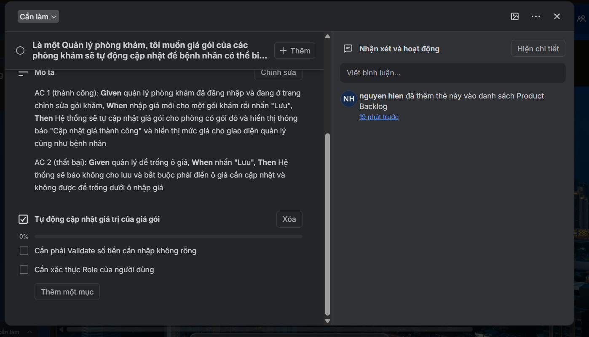
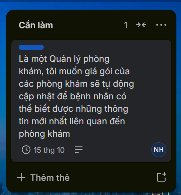

| **Mã** | **Yêu cầu**                                                   | **Ai đề xuất**                                                       |
| ------------- | --------------------------------------------------------------------- | ----------------------------------------------------------------------------- |
| R3            | "Bệnh nhân phải thấy được phòng khám nào đang gần mình." | Bệnh nhân (đã làm mẫu bên dưới)                                      |
| R5            | "Phòng khám muốn tự cập nhật giá các gói khám."             | Quản lý phòng khám. Hiện admin RikkeiCare đang cập nhật hộ qua email |

**Mẫu cho R3:**

**User Story:** Là một bệnh nhân, tôi muốn xem các phòng khám gần vị trí của mình, để chọn nơi khám thuận tiện nhất.

**AC 1:** **Given** bệnh nhân đã bật định vị, **When** mở trang chủ, **Then** ứng dụng hiện các phòng khám trong bán kính 5 km, xếp từ gần đến xa.

**Bước 1. Viết User Story cho R5**

Viết User Story cho R5, và giải thích vì sao bạn chọn vai trò đó chứ không phải "admin RikkeiCare".

+ Là một Quản lý phòng khám đã đăng nhập thành công với hệ thống, tôi muốn khi cập nhật giá của phòng khám thì giá gói của các phòng khám sẽ tự động cập nhật giá để bệnh nhân có thể biết được những thông tin mới nhất liên quan đến phòng khám và giá gói chọn
+ Lý do vì Quản lý phòng khám là người nói nên yêu cầu này chứ không phải là admin RikkeiCare

**Bước 2. Viết phần Then cho 2 AC của R5**

AC 1 (thành công): **Given** quản lý phòng khám đã đăng nhập và đang ở trang chỉnh sửa gói khám, **When** nhập giá mới cho một gói khám rồi nhấn "Lưu", **Then** Hệ thống sẽ tự cập nhật giá gói cho phòng có gói đó và hiển thị thông báo "Cập nhật giá thành công" và hiển thị mức giá cho giao diện quản lý cũng như bệnh nhân

AC 2 (thất bại): **Given** quản lý để trống ô giá, **When** nhấn "Lưu", **Then** Hệ thống sẽ báo không cho lưu và bắt buộc phải điền ô giá cần cập nhật và không được để trống dưới ô nhập giá

**Bước 3. Thẻ R5 đã sẵn sàng chưa?**

Product Owner muốn kéo thẻ R5 (đã có User Story và 2 AC) sang cột "Ready for Sprint". Definition of Ready (điều kiện để thẻ được đưa vào Sprint) của nhóm gồm 4 điều:

* Có User Story đủ 3 vế.
* Có tiêu chí nghiệm thu.
* Đã được ước lượng.
* Đủ nhỏ để làm xong trong 1 Sprint.

Thẻ R5 kéo sang được chưa? Vì sao?

Thẻ R5 chưa được kéo sang Ready for Sprint vì yêu cầu này vẫn chưa được bên Team Developers chưa đưa ra ước lượng và Team Scrum chưa xác nhận thẻ R5 này có đủ nhỏ để có thể kéo vào Ready for Sprint

**Bước 4. Hoàn thiện thẻ R5 trên Trello**

Thẻ R5 đã được chọn vào Sprint. Quy ước nhãn của nhóm: Đỏ là Bug, Xanh dương là Feature, Vàng là Technical debt, Tím là Epic.

Ghi nhãn, người phụ trách, 2–3 mục checklist và hạn hoàn thành cho thẻ R5. Nếu R5 là việc ưu tiên cao nhất, thẻ đặt ở đâu trong cột?

Nếu là vậy thì sẽ để Thẻ 5 sẽ là Màu xanh dương và để ở cột To do (Cần làm)

